# [FREE] [MAP] The Very Enchanting Tree House

Welcome to The Very Enchanting Tree House.

An ancient tree on the Paleto Bay coast, about 34 m tall. A spiral stair climbs inside its hollow trunk to rooms built in the branches, linked by plank bridges and two open terraces, with a stone path leading up to the door.

## Features
- Walkable spiral stair inside the trunk
- Living room, kitchen, bedroom and reading nook, all furnished
- Two terraces, linked by plank bridges
- Doors that swing open as you walk through
- Night lighting built in: trunk uplights, glowing windows, lit bridges (19:00-06:00)
- No framework, no database, no scripts

```
/tp 3406.36, 5505.72, 25.41
```

## Preview
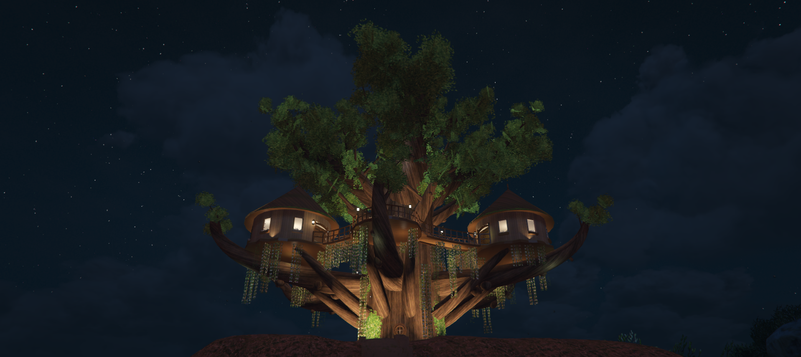
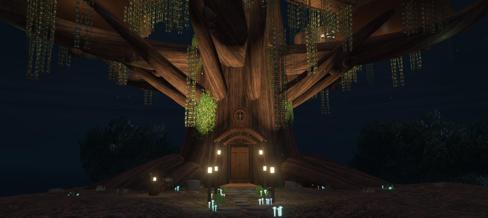
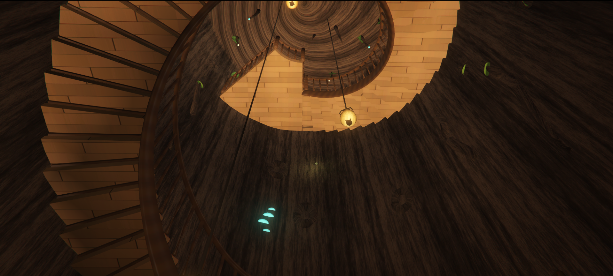
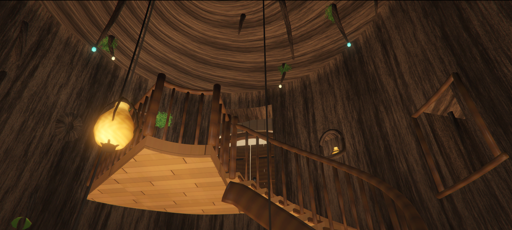
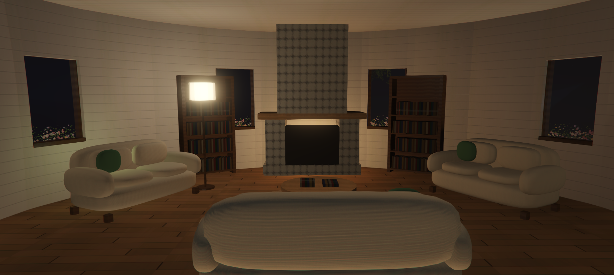
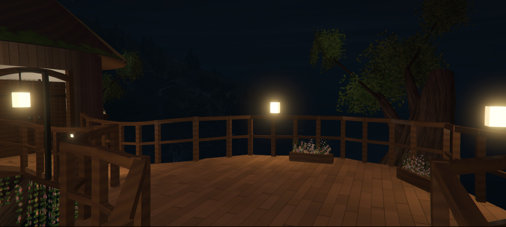
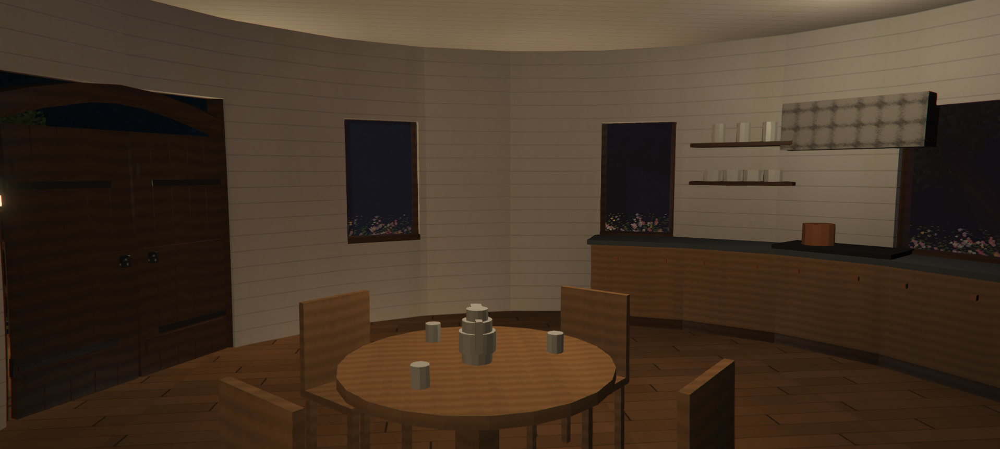
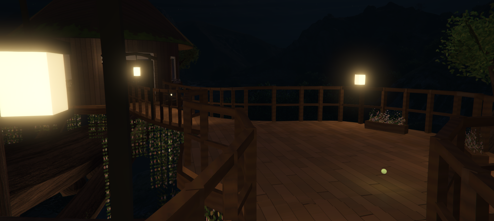
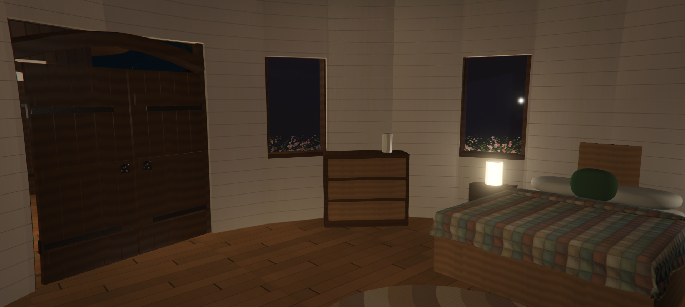
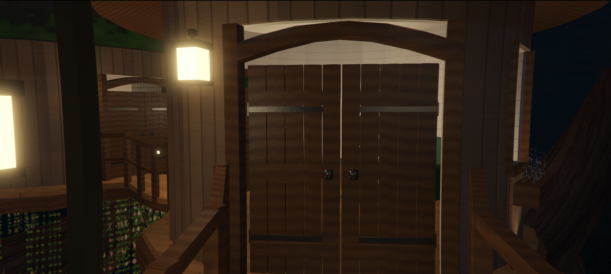
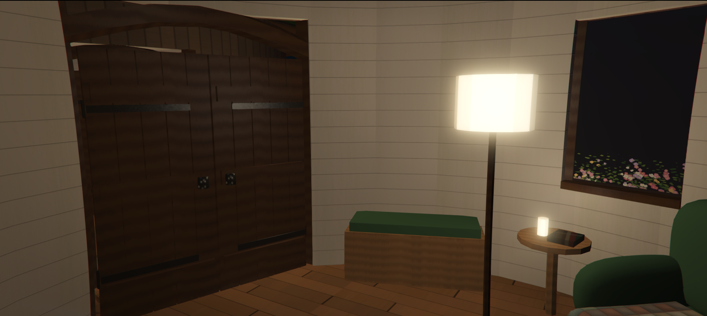
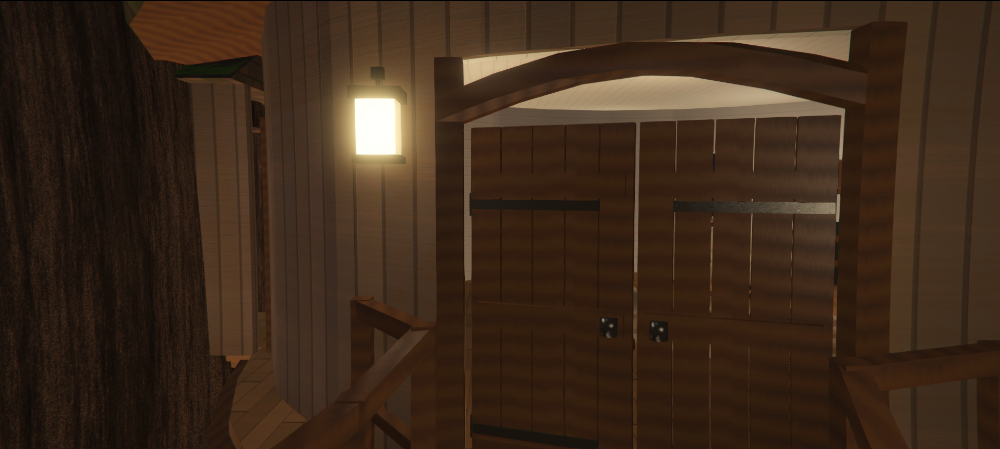

## Download
**GitHub:** https://github.com/OlentrixAssets/the_enchanted_treehouse

## Installation
It's literally like every other FiveM map resource. Drop it into your standalone resources folder, add `ensure olentrix_assets_the_enchanted_treehouse` to your server.cfg, and restart your server.

Congratulations, you've successfully installed a tree.

## Textures
All textures are conveniently packed into YTD files, making them easy to modify, customize, or completely ruin with your own questionable decisions.

## License
Free to use and edit on your own server. No resale, re-uploading, or sharing.

Remember, don't run with scissors, don't play in traffic, and for the love of everything holy, stop asking why your map isn't working when you forgot to ensure the resource.

Good day, you magnificent deviants.

---

| | |
|-|-|
| Code is accessible | Yes |
| Subscription-based | No |
| Lines (approximately) | 0 (map only) |
| Requirements | None, standalone |
| Support | Yes |

**Made with:** Blender 5.2.3 · Sollumz 2.9.0 · CodeWalker (Latest Release) · DirectXTex texconv 2026.5.8.1 · OpenIV 4.1
